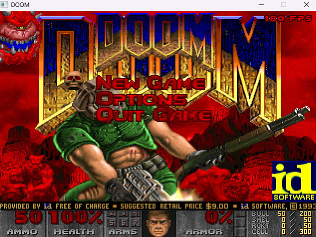

# cobol_doom



**Video:** [DOOM running in GnuCOBOL — 80 to 180 FPS](https://youtu.be/fAJ51Vo9T58)

DOOM generic ported from **[python_doom](https://github.com/vagucs/python_doom)** to **GnuCOBOL + SDL2**.

By **Wagner Nunes da Silva**

- vagucs@bol.com.br
- vagucs@vagucs.com.br
- vagucs@gmail.com
- [www.vagucs.com.br](https://www.vagucs.com.br)
- [LinkedIn](https://www.linkedin.com/in/wagner-nunes-da-silva-b0a15360)

Yes: the game is written in COBOL. The loop, the map, the view, the doors, the weapons, the monsters, the menu, and the tally live in the `.cob` files. Six files under `src/` are the edge GnuCOBOL does not cover: the SDL2 window, sound, binary WAD reads, 32-bit arithmetic, automap scaling, and the save files. The mouse stays out.

Versão em português: [README.pt.md](README.pt.md)

---

## What this project is

`python_doom` is a condensed, playable DOOM engine in Python. This directory is the **same study piece**, rewritten in COBOL:

- Window, keys, blit, and PCM: **SDL2**, reached from COBOL with `CALL`
- Framebuffer: 320×200, stretched to a 640×400 window
- Step: about 28 ms, close to the 35 Hz tic
- View: BSP, walls, floor, ceiling, sky, sprites, and the weapon
- Map: VERTEXES, LINEDEFS, SIDEDEFS, SECTORS, SEGS, SSECTORS, NODES, THINGS, BLOCKMAP, REJECT
- Play: walking, doors, lifts, stairs, teleporters, switches, the exit, items, weapons, the status bar, the Tab automap, `DS*` sounds, MUS→MIDI music, the Esc menu, skill select, six save slots, the tally, the screen melt, the episode finale (including the episode 3 bunny), and monsters that look, chase, and attack

You need a legal IWAD (shareware `doom1.wad` or commercial `doom.wad` / `doom2.wad`). This repository does not ship commercial WAD data.

It is a **condensed educational port**: the engine is COBOL. The C layer is only what `CALL` needs in order to leave the program.

Left out of this tree:

- Mouse
- Network, joystick, CD audio
- Vanilla binary saves (the slots are text, `doomsav0.dsg` through `doomsav5.dsg`, headed by `COBDOOM1`)

---

## Educational purpose

This project is a **study piece**. The Python port already dropped the preprocessor and Harbour's 1-based arrays. The COBOL port asks a different question: **what survives when the records are `OCCURS` tables and the arithmetic wants to be decimal**.

What it is meant to teach:

- **Python, then COBOL.** Open `python_doom/doom/` next to `cobol_doom/`. The names stay close (`fixed_mul`, `as_i32`) so the two files can sit side by side.
- **32-bit wrap, outside `COMPUTE`.** A GnuCOBOL `COMPUTE` on `BINARY-LONG` rounds. A 16.16 product has to wrap the way C wraps. That math lives in `src/compat.c`, the same helpers as `doom/compat.py`, and COBOL calls them.
- **1-based tables, 0-based data.** `OCCURS` starts at 1. WAD lumps stay 0-based in the data and are stored at lump number `+ 1`.
- **Where COBOL is enough.** Who fires, which door opens, and what lands in the framebuffer stay in the `.cob` files. C does not pick a game rule.

Suggested way to study:

1. Run `run.bat`, then read `main.cob` — the IWAD, the menu, and the 28 ms loop.
2. Compare `view.cob` with `python_doom/doom/render.py`, `map.cob` with `doom/world.py`, and `wad.cob` with `doom/wad.py`.
3. Compare `src/compat.c` with `doom/compat.py`. `src/video.c` never reads the mouse.

---

## From Python to COBOL

Python lists are 0-based. `OCCURS` is 1-based. An object becomes an `EXTERNAL` group shared by the programs, through a `COPY`.

| Python (`python_doom`) | COBOL (`cobol_doom`) |
| --- | --- |
| `thing.x` | `mo-x(i)` or `ply-x` |
| `None` | spaces, or zero |
| `items[0]` | `OCCURS`, slot = index + 1 |
| class | `PROGRAM-ID` plus an `EXTERNAL` `COPY` |
| unbounded `int` | `BINARY-LONG`, 32 bits; the wide product stays in C |
| `&`, `\|`, `^` | `CALL "bit_and"`, `bit_or`, `bit_xor` |
| `x >> n` | `CALL "ushr32"` / `CALL "shar32"` |
| `a // b` | `DIVIDE` without `ROUNDED`, or `CALL "floor_div_i"` |
| `fixed_mul` / `fixed_div` | `CALL "fixed_mul"` / `CALL "fixed_div"` |
| framebuffer `bytearray` | `PIC X(64000)` |
| pygame | SDL2, through `CALL` |
| `+=` | `CALL "add_i32"` — a `COMPUTE` rounds |

A field in an `EXTERNAL` `COPY` shows up in the other programs, the same way a Python object does.

### Side by side: the push

Python (`doom/player.py`):

```python
def thrust(mo: Mobj, angle: int, move: int) -> None:
    mo.momx += fixed_mul(move, fine_cos(angle))
    mo.momy += fixed_mul(move, fine_sin(angle))
```

COBOL (`walk.cob`), inside the walk tic:

```cobol
CALL "fine_cos_ang" USING BY VALUE ply-ang RETURNING cs
CALL "fine_sin_ang" USING BY VALUE ply-ang RETURNING sn
CALL "fixed_mul" USING BY VALUE move-n BY VALUE cs RETURNING tmp
CALL "add_i32" USING BY VALUE ply-momx BY VALUE tmp RETURNING ply-momx
CALL "fixed_mul" USING BY VALUE move-n BY VALUE sn RETURNING tmp
CALL "add_i32" USING BY VALUE ply-momy BY VALUE tmp RETURNING ply-momy
```

Python adds into the object field. COBOL does the same two 16.16 multiplies, and `add_i32` brings the sum back inside 32 bits. The angle's sine and cosine come from C as well, because the fine table does not fit a decimal `COMPUTE`.

---

## What stayed in C, and why

The engine is COBOL. Each file below is a function `CALL` can reach. None of them chooses the level, the weapon, or the monster.

| File | Role | Why it is not COBOL |
| --- | --- | --- |
| `src/video.c` | SDL2 window, palette, keyboard, Alt+Enter | The compiler does not link SDL2 |
| `src/audio.c` | PCM queue for `DS*` lumps, and MIDI through MCI | The sound device and `winmm` |
| `src/wadio.c` | Binary reads and the IWAD path | `PIC X` pads with spaces; a lump is raw bytes |
| `src/compat.c` | 32-bit wrap, 16.16, sine, arctangent, BSP side | `COMPUTE` rounds, and the product wraps differently from C |
| `src/mapdraw.c` | Fit the plan, the arrow, and a patch column | Floating-point scale and patch posts |
| `src/slotio.c` | Open `doomsavN.dsg` and read one line | COBOL builds the save text; the file needs a real end of line |

`sound.cob` decides which effect plays. `audio.c` only mixes. `save.cob` builds the slot text. `slotio.c` only writes and reads the line. `map.cob` picks each wall color. `mapdraw.c` only turns a coordinate into a pixel.

---

## Technology

| Layer | This port | Python (`python_doom`) |
| --- | --- | --- |
| Language | GnuCOBOL 3.2 | Python 3.10+ |
| Window, keys, blit | SDL2, `CALL` from COBOL | pygame 2.x |
| Sound | SDL2 for effects, MCI for MIDI | the pygame mixer, MCI on Windows |
| 16.16 fixed-point | `src/compat.c` | `doom/compat.py` |
| Mouse | left out | used for look and fire |
| IWAD | the same lumps | the same lumps |
| Build | `run.bat` (`cobc` + the UCRT64 gcc) | `pip install -r requirements.txt` |

The compiler used here is the MSYS2 package `mingw-w64-ucrt-x86_64-gnucobol`, with `gcc` and `SDL2` from `C:\msys64\ucrt64`. `run.bat` puts that `bin` folder on `PATH` so `SDL2.dll` is found.

---

## How to run

From this directory, on Windows:

```
run.bat
```

`build.bat` only compiles. The window is 640×400. The texture is 320×200.

The IWAD is the first file that exists among `DOOM1.WAD`, `doom1.wad`, `DOOM.WAD`, `doom.wad`, `DOOM2.WAD`, `doom2.wad`, `PLUTONIA.WAD`, `TNT.WAD`, `freedoom1.wad`, and `freedoom2.wad`. The search starts at `DOOMWADDIR` or `DOOMWADPATH` when that variable is set, then the current folder and parent folders. `-iwad` chooses the file. A bare path ending in `.wad` also works. `-fps` shows the frames per second in the top-right corner.

```
run.bat -iwad C:\wads\doom1.wad -fps
```

When the IWAD contains `MAP01`, a new game skips the episode menu, asks for the skill, and opens MAP01. In the shareware, episode 1 is the only one; the others say they need the registered version.

---

## Keys

Letters do not move the player. They feed the cheats. Movement stays on the arrows.

| Key | Action |
| --- | --- |
| **Arrows** | Forward, back, turn |
| **Shift** | Run |
| **Alt** with left or right | Strafe |
| **Comma** and **period** | Strafe |
| **Space** or **E** | Use whatever is ahead |
| **Ctrl** | Fire. Holding repeats, except the BFG |
| **1** through **7** | Fist, pistol, shotgun, chaingun, rocket, plasma, BFG. **1** takes the chainsaw once it has been picked up |
| **Tab** | Automap. The game keeps ticking underneath |
| **-** / **=** | Smaller or larger view |
| **Alt+Enter** | Full screen |
| **Esc** | Menu. On the title screen, quit |
| Close the window | Quit |

The mouse is ignored. Leaving the game is the Quit item on the menu.

### Cheats

Type them during a level, with the menu closed. No Enter.

| Code | Effect |
| --- | --- |
| **IDDQD** | God mode |
| **IDKFA** | Every weapon, ammo, the keys, and armor |
| **IDFA** | Weapons, ammo, and armor |
| **IDCLIP** / **IDSPISPOPD** | No clipping |
| **IDCHOPPERS** | Chainsaw |
| **IDMYPOS** | Coordinates and angle |
| **IDDT** | On the map: every wall, then the things, then back to normal |
| **IDBEHOLD** | Then **V** **S** **I** **R** **A** **L** (invulnerable, strength, invisible, suit, computer map, light) |
| **IDMUS** + 2 digits | Change the music |
| **IDCLEV** + 2 digits | Warp. `16` opens E1M6. On an IWAD that has `MAP01`, the number is the map |

The six slots are the Load and Save menu items. The stored description is the map name.

---

## Layout

```
main.cob             loop, menu, keys, and the level change
walk.cob             one movement tic
door.cob             doors, lifts, stairs, teleporters, switches
gun.cob              weapons, the shot, and the blast
enemy.cob            monsters
status.cob           the bar and the face
item.cob             floor items
cheat.cob            cheats
ui.cob               title, menus, tally, and the melt
sound.cob            which effect or song to play
finale.cob           end text, the cast, and the bunny
save.cob             text of the six slots
view.cob             the 3D view
sprites.cob          frames and what spawns on the map
map.cob              map load and the plan drawing
rdata.cob            textures, flats, and the colormap
wad.cob              the IWAD directory
vvideo.cob           a patch and a line on the framebuffer
screenshot/doom.png  the picture at the top
src/                 the C edge, described above
```

| Path | Python |
| --- | --- |
| `src/compat.c` | `doom/compat.py` |
| `wad.cob` | `doom/wad.py` |
| `src/video.c`, `src/audio.c` | `doom/video.py`, `doom/sound.py` |
| `vvideo.cob` | `doom/v_video.py` |
| `rdata.cob` | `doom/r_data.py` |
| `view.cob` | `doom/render.py` |
| `map.cob` | `doom/world.py` and the plan from `doom/am_map.py` |
| `walk.cob`, `gun.cob` | `doom/player.py` |
| `door.cob` | `doom/specials.py` |
| `sprites.cob` | `doom/sprites.py` |
| `enemy.cob` | `doom/enemy.py` |
| `status.cob` | `doom/status.py` |
| `sound.cob` | what `doom/sound.py` chooses to play |
| `ui.cob` | `doom/menu.py`, `doom/wi_stuff.py`, `doom/wipe.py` |
| `finale.cob` | `doom/finale.py` |
| `save.cob`, `src/slotio.c` | `doom/saveg.py` |
| `cheat.cob` | the cheat machine in `doom/game.py` |
| `main.cob` | the Python entry |

---

## Lineage

1. **[python_doom](https://github.com/vagucs/python_doom)** — Python + pygame
2. **cobol_doom** — GnuCOBOL + SDL2 (this tree)

---

## Donate

### GitHub Sponsors

[github.com/sponsors/vagucs](https://github.com/sponsors/vagucs)

### Ethereum

`0x1b64038A2b1DB73ABd0068d8B9B0d1dC5a90C5F1`


### PIX

Key: `vagucs@bol.com.br`


